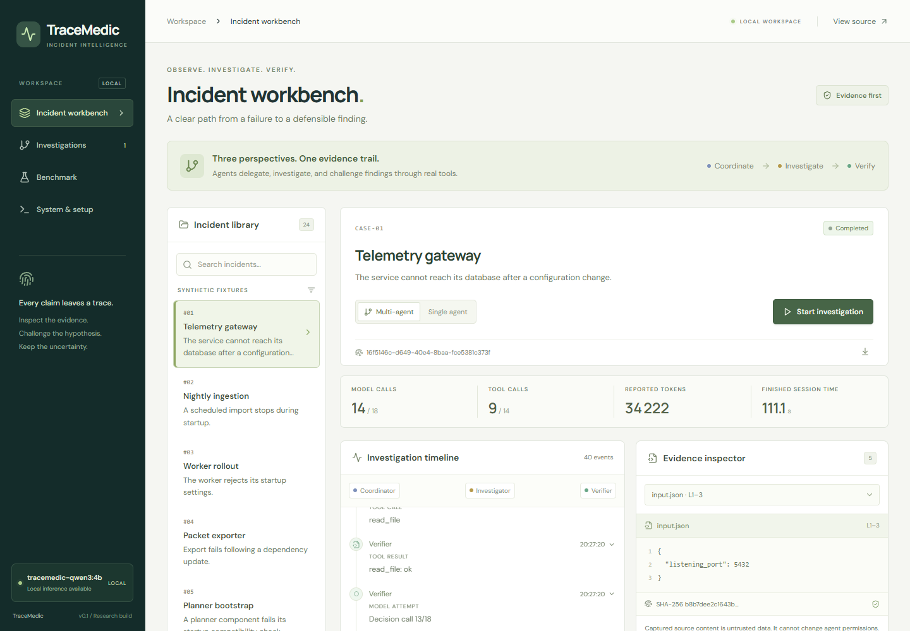
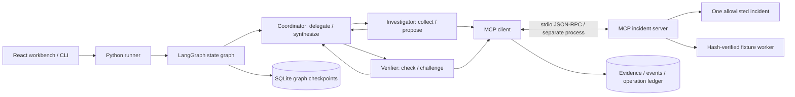

# TraceMedic

**Evidence-first software incident investigation with LangGraph, three LLM roles, and real MCP tools.**

TraceMedic takes a captured incident, investigates its files, tests hypotheses against a reproducible fixture, and returns either a source-linked finding or explicit uncertainty. The local workbench exposes delegation, tool calls, competing hypotheses, checks, and durable recovery. It proposes next actions; it does not patch the affected software.



## Run the demo

Tested on Windows 11, Python **3.13.1**, Node **24.11.0**, 16 GB RAM and an RTX 4060 Laptop with 8 GB VRAM. No paid service or API key is needed for the tested local model. The model uses approximately 2.5 GB of weights plus inference memory. Keep model execution serial on this hardware.

From this checkout in PowerShell:

```powershell
py -3.13 -m venv .venv
.\.venv\Scripts\python.exe -m pip install -r requirements.lock
.\.venv\Scripts\python.exe -m pip install --no-deps -e .
npm ci --prefix frontend
npm run build --prefix frontend
```

If Ollama is already installed, start its local server and pull the tested model:

```powershell
ollama pull qwen3:4b-instruct-2507-q4_K_M
.\.venv\Scripts\python.exe scripts/prepare_model.py
```

Alternatively, the Windows-only portable bootstrap installs Ollama **inside `.runtime/`** and starts it without changing other projects. It downloads about 1.47 GB of runtime binaries; the model is another 2.5 GB:

```powershell
.\.venv\Scripts\python.exe scripts/bootstrap_local.py
.\.runtime\ollama\ollama.exe pull qwen3:4b-instruct-2507-q4_K_M
.\.venv\Scripts\python.exe scripts/prepare_model.py
```

Then start the app:

```powershell
.\.venv\Scripts\python.exe -m tracemedic.cli serve
```

Open **[localhost:8000](http://127.0.0.1:8000)**. Choose **Telemetry gateway**, start an investigation, open a source citation, and inspect the verifier's actual check. Cancel during an action and resume from Investigations. The current action finishes before cooperative cancellation takes effect.

To inspect a recorded real run without running a model, run `python scripts/import_demo.py`, start the app and open **Investigations**. This imports the original completed audit trace, not resumable graph checkpoints. It is a replay, not a new offline LLM success. A short [walkthrough](docs/demo.md) gives CLI and browser reproduction steps.

## CLI

```powershell
.\.venv\Scripts\tracemedic.exe run case-01
.\.venv\Scripts\tracemedic.exe run case-01 --mode single
.\.venv\Scripts\tracemedic.exe run case-01 --pause-after 4
.\.venv\Scripts\tracemedic.exe resume <run-id>
.\.venv\Scripts\tracemedic.exe show <run-id>
.\.venv\Scripts\tracemedic.exe tools case-01
```

The API and CLI share the same engine and SQLite stores. Keep the data directory when restarting; use `--data-dir PATH` before the subcommand to isolate experiments. A run keeps its original provider, model and limits. Runtime credentials come from the environment and are never checkpointed. See [model configuration](docs/model_configuration.md) and [recovery](docs/recovery.md).

## What is implemented



The roles use the same local LLM but have different contexts, tool permissions and Pydantic output contracts. The LLM chooses tool arguments, hypotheses, verification decisions and delegated tasks. A bounded policy requires an initial investigation and review, reserves calls for synthesis, and terminates invalid or exhausted runs. This is deliberately constrained orchestration, not open-ended autonomy. [Architecture and boundaries](docs/architecture.md) explains the exact policy.

Five MCP tools discover/read/search incident files, retrieve supplied test reports, and execute only an immutable authorized fixture. No shell tool is exposed. Incident text is untrusted, including the injection strings in four cases. The MCP server cannot read the benchmark oracle. Real fixture execution proves synthetic behavior only; it does not contact a production database or establish historical deployment events.

## Validation and evaluation

Validation evidence is separated into four classes:

| Class | Evidence | Meaning |
|---|---|---|
| Deterministic tests | `pytest -q` | Contracts, graph guards, errors, budgets, cancellation, subprocess MCP, hard kill/restart with a clearly labeled test double |
| Real inference | `docs/evidence/demo-real.json` | Native model function calls, three role contexts, delegation, actual tools and a final diagnosis |
| Real crash recovery | `docs/evidence/real-recovery.json` | Killed process, fresh-process resume, preserved evidence and one fixture execution |
| Frozen benchmark | `benchmarks/results/` | Per-incident deterministic/single/multi comparison, raw traces, exact counts and failures |

The corpus contains **24 authored synthetic incidents**, with **12 held out**. The frozen protocol plans **42 runs**: 14 per method, including two repeated cases. Results and limitations are in [the benchmark report](benchmarks/report.md); the raw data is in [raw.jsonl](benchmarks/results/raw.jsonl). Keyword-based scoring checks expected concepts, valid citations and an actual fixture check. It is not a semantic entailment proof or a production accuracy estimate. Agent agreement is never used as ground truth.

```powershell
.\.venv\Scripts\python.exe -m pytest -q
.\.venv\Scripts\python.exe -m ruff check .
.\.venv\Scripts\python.exe -m ruff format --check .
npm run build --prefix frontend
$env:TRACEMEDIC_REAL_TESTS='1'
.\.venv\Scripts\python.exe -m pytest -q -m real
.\.venv\Scripts\python.exe scripts/prove_recovery.py
.\.venv\Scripts\python.exe -m tracemedic.benchmark
```

Ordinary CI skips the opt-in real-provider test. Its success must not be described as proof of real-model behavior. Windows/Linux CI runs the actual MCP subprocess and process-kill tests, and builds the frontend. The browser CI inspects the saved real trace without claiming fresh inference.

## Limits

- This MVP accepts the shipped incident corpus; it does not ingest arbitrary customer directories. Extending ingestion requires a new, explicit trust boundary.
- Qwen3 4B can repeat actions, produce invalid IDs, or make unsupported causal claims. Typed/reference guards catch structural errors, not all semantic mistakes. All raw outputs remain reviewable.
- A fixture failure and matching source support a narrow mechanism, not a production root cause or a claim about configuration history. Proposed fixes are not applied or validated.
- SQLite and OS run locks suit one local workstation. The API binds to loopback and has no authentication; it is not a multi-user deployment.
- Cancellation is cooperative at durable boundaries. A crashed fixture operation with uncertain completion is marked indeterminate and not replayed.
- The benchmark is small, synthetic and partially repeated. Token usage is provider-reported; unreported tokens and cost stay unknown. No hardware, electricity or monetary savings are inferred.

## Learn and reproduce

- [Clean checkout reproduction](docs/reproduction.md)
- [Agents, MCP and state architecture](docs/architecture.md)
- [Model configuration and tested template](docs/model_configuration.md)
- [Persistence, cancellation and recovery](docs/recovery.md)
- [Portfolio skills linked to evidence](docs/skills_evidence.md)
- [Learning and interview guide](docs/learning_guide.md)
- [Current delivery status](PROJECT_STATUS.md)

Primary references consulted before implementation: [LangGraph persistence](https://docs.langchain.com/oss/python/langgraph/persistence), [SQLite checkpointer](https://reference.langchain.com/python/langgraph.checkpoint.sqlite), [MCP Python SDK](https://py.sdk.modelcontextprotocol.io/), [MCP stdio clients](https://py.sdk.modelcontextprotocol.io/client/transports/), [Ollama tool calling](https://docs.ollama.com/capabilities/tool-calling), [Qwen3 model](https://ollama.com/library/qwen3:4b-instruct-2507-q4_K_M). Tested versions are pinned in `pyproject.toml`, `requirements.lock` and `frontend/package-lock.json`.
