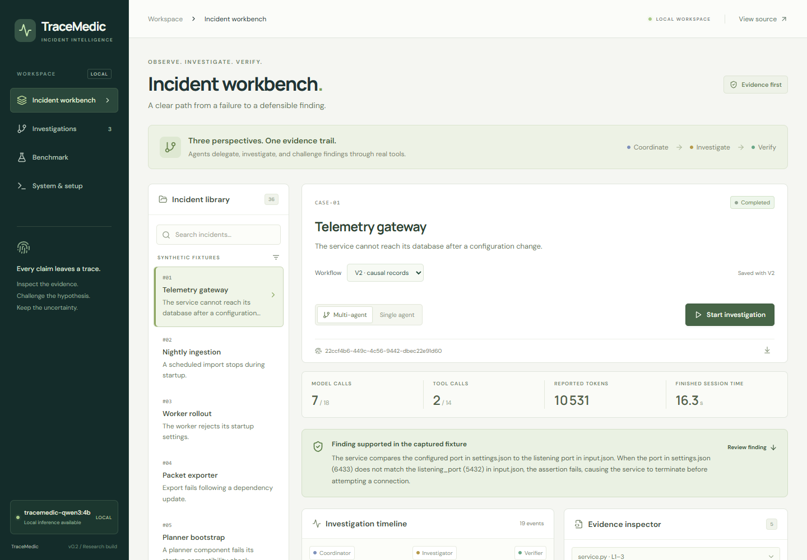
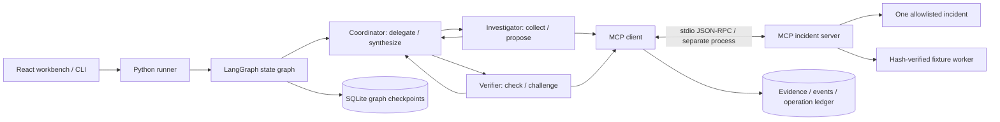

# TraceMedic

**V2 — evidence-first software incident investigation with LangGraph, three LLM roles, and real MCP tools.**

TraceMedic takes a captured incident and explains a proposed **trigger → mechanism → observed effect**, or returns explicit uncertainty. Every causal record links to captured source lines and executed checks. The workbench exposes delegation, challenges, isolated experiments and durable recovery. Next actions remain proposals; no repair is applied.



## What changed in V2

- **Review one causal record.** Investigator proposes a mechanism, verifier reviews that same record, coordinator selects the final finding and next actions. Final factual text comes from reviewed records; scope limits come from check states.
- **Open the actual line.** The model selects `E2:L3`; the host attaches exact captured text. Click a citation to open and highlight that line. This prevents fabricated quotation text, not faulty reasoning.
- **Collect once, test deliberately.** Bounded `read_bundle` reduces round trips. `run_experiment` compares baseline with an isolated JSON configuration/input change on hash-verified fixtures, keeping code and expected results unchanged.
- **Smaller contexts and honest uncertainty.** Excerpts are not duplicated into action histories. Passed/unavailable checks cannot establish a cause. Invalid confirmations become unresolved rather than repeatedly failing the same action.
- **Preserve the comparison.** V1 remains available and old investigations resume with their original runner. V2 has a fresh reserved suite, all scheduled outcomes and a common V1/V2 rubric.

The [proposal and primary research](docs/v2_proposal.md) explain the decisions; [V2 architecture](docs/v2_architecture.md) describes the exact guards and remaining limits. The V1 reference is preserved at tag `v0.1.0`; V2 work is on `codex/v2-evidence`.

## Run the demo

Tested on Windows 11, Python **3.13.1**, Node **24.11.0**, 16 GB RAM and an RTX 4060 Laptop with 8 GB VRAM. No paid service or API key is needed for the tested local model. The model uses approximately 2.5 GB of weights plus inference memory. Keep model execution serial on this hardware.

From this checkout in PowerShell:

```powershell
py -3.13 -m venv .venv
.\.venv\Scripts\python.exe -m pip install -r requirements.lock
.\.venv\Scripts\python.exe -m pip install --no-deps -e .
npm ci --prefix frontend
npm run build --prefix frontend
```

If Ollama is already installed, start its local server and pull the tested model:

```powershell
ollama pull qwen3:4b-instruct-2507-q4_K_M
.\.venv\Scripts\python.exe scripts/prepare_model.py
```

Alternatively, the Windows-only portable bootstrap installs Ollama **inside `.runtime/`** and starts it without changing other projects. It downloads about 1.47 GB of runtime binaries; the model is another 2.5 GB:

```powershell
.\.venv\Scripts\python.exe scripts/bootstrap_local.py
.\.runtime\ollama\ollama.exe pull qwen3:4b-instruct-2507-q4_K_M
.\.venv\Scripts\python.exe scripts/prepare_model.py
```

Then start the app:

```powershell
.\.venv\Scripts\python.exe -m tracemedic.cli serve
```

Open **[localhost:8000](http://127.0.0.1:8000)**. Choose **Telemetry gateway**, **V2 · causal records**, and start an investigation. Read the outcome first, open a quoted line, and inspect the verifier's actual check or isolated trial. Cancel during an action and resume from Investigations. The current action finishes before cooperative cancellation takes effect.

To inspect a recorded real run without running a model, run `python scripts/import_demo.py --workflow v2`, start the app and open **Investigations**. `--workflow v1` imports the original reference trace. Imports restore audit traces, not resumable graph checkpoints. Replay is not new inference. A short [walkthrough](docs/demo.md) gives CLI and browser reproduction steps.

## CLI

```powershell
.\.venv\Scripts\tracemedic.exe run case-01
.\.venv\Scripts\tracemedic.exe run case-01 --mode single
.\.venv\Scripts\tracemedic.exe --workflow v1 run case-01
.\.venv\Scripts\tracemedic.exe run case-01 --pause-after 4
.\.venv\Scripts\tracemedic.exe resume <run-id>
.\.venv\Scripts\tracemedic.exe show <run-id>
.\.venv\Scripts\tracemedic.exe tools case-01
```

The API and CLI share the same engine and SQLite stores. Keep the data directory when restarting; use `--data-dir PATH` before the subcommand to isolate experiments. A run keeps its original provider, model and limits. Runtime credentials come from the environment and are never checkpointed. See [model configuration](docs/model_configuration.md) and [recovery](docs/recovery.md).

## What is implemented



The roles use the same local LLM but have different contexts, tool permissions and Pydantic contracts. The LLM chooses tool arguments, hypotheses, verification decisions, delegated tasks and final selection. A bounded policy requires investigation and review, reserves calls for synthesis, and terminates invalid or exhausted runs. V2 uses native function calls for MCP/action choices and Ollama JSON-schema decoding when exactly one control contract is permitted. Every decision still consumes a real model call. This is constrained orchestration; [V2 architecture](docs/v2_architecture.md) explains the policy and [V1 architecture](docs/architecture.md) preserves the reference.

V1 has five MCP tools; V2 adds bundle reads and isolated JSON experiments. The server runs in a separate stdio process bound to one incident. No shell or arbitrary source edits are exposed. Incident text is untrusted, including adversarial strings in both suites; the MCP server cannot read the oracle. Fixture execution concerns synthetic behavior, without production resource access or claims about deployment history.

## Validation and evaluation

Validation evidence is separated into four classes:

| Class | Evidence | Meaning |
|---|---|---|
| Deterministic tests | `pytest -q` | Contracts, graph guards, errors, budgets, cancellation, subprocess MCP, hard kill/restart with a clearly labeled test double |
| Real V2 inference | `docs/evidence/v2/demo-real.json` | Real model decisions, three role contexts, delegation, actual tools, cancellation/resume and a final finding |
| Real V2 crash recovery | `docs/evidence/v2/real-recovery.json` | Killed process, fresh-process resume, preserved evidence/aliases and one fixture execution |
| Frozen V2 benchmark | `benchmarks/v2/results/` | Rules / V1 multi / V2 single / V2 multi, all scheduled traces and failures |

### V2 comparison

<!-- V2_RESULTS_START -->
All **56/56** scheduled runs are recorded on twelve fresh reserved cases (four methods, fourteen runs each). Same model and top-level budgets; V2 improves contracts, context and tools.

| Method | Correct automatic outcomes | Median wall time | Model calls across 14 runs |
|---|---:|---:|---:|
| deterministic | 3 / 14 | 1.92 s | 0 |
| v1-multi | 7 / 14 | 37.42 s | 200 |
| v2-single | 6 / 14 | 11.53 s | 73 |
| v2-multi | 8 / 14 | 14.01 s | 99 |

These are automatic synthetic-suite outcomes, not production accuracy or semantic proof. Read the [full V2 comparison](benchmarks/v2/report.md), [semantic audit](benchmarks/v2/semantic_audit.md) and [all raw runs](benchmarks/v2/results/raw.jsonl). The invalidated preliminary attempt is preserved separately. The old V1 score below uses a different set/rubric and is not a V2 improvement baseline.
<!-- V2_RESULTS_END -->

### V1 reference study

The corpus contains **24 authored synthetic incidents**, with **12 held out**. The frozen protocol executed **42 runs**: 14 per method, including two repeated cases. Results and limitations are in [the benchmark report](benchmarks/report.md); all traces are in [raw.jsonl](benchmarks/results/raw.jsonl).

| Method | Correct automatic outcomes | Median wall time | Model calls across 14 runs |
|---|---:|---:|---:|
| Deterministic rules | 5 / 14 | 1.84 s | 0 |
| Single agent | 10 / 14 | 28.24 s | 137 |
| Three agents | 9 / 14 | 39.46 s | 198 |

The multi-agent variant did **not** outperform the single agent in this experiment. Both LLM variants had three supported conclusions rejected by the automatic scorer and one non-completed run. Keyword scoring checks expected concepts, valid citations and actual execution; it can reject a correct paraphrase and miss unsupported sentences. [Scoring notes](benchmarks/scoring_notes.md) explain concrete limits. These results are not production accuracy estimates. Agent agreement is never used as ground truth.

```powershell
.\.venv\Scripts\python.exe -m pytest -q
.\.venv\Scripts\python.exe -m ruff check .
.\.venv\Scripts\python.exe -m ruff format --check .
npm run build --prefix frontend
$env:TRACEMEDIC_REAL_TESTS='1'
.\.venv\Scripts\python.exe -m pytest -q -m real
.\.venv\Scripts\python.exe scripts/prove_recovery.py --workflow v2
.\.venv\Scripts\python.exe -m tracemedic.v2.benchmark
```

Ordinary CI skips opt-in real-provider tests. Its success is not evidence of fresh inference. Windows/Linux CI runs actual MCP and process-kill tests, then builds the frontend. Browser CI inspects both V1 and V2 real saved traces. V2 also has source-line, unavailable-check, experiment-boundary, encoding and versioned API tests.

## Limits

- V2 accepts the 36 shipped synthetic incidents; it does not ingest arbitrary customer directories. Extending ingestion requires an explicit trust boundary.
- Qwen3 4B can repeat actions, produce invalid IDs, or make unsupported causal claims. Typed/reference guards catch structural errors, not all semantic mistakes. All raw outputs remain reviewable.
- A fixture failure and matching source support a narrow mechanism, not a production root cause or a claim about configuration history. Isolated trials can validate a changed synthetic result; proposed production actions remain unvalidated.
- SQLite and OS run locks suit one local workstation. The API binds to loopback and has no authentication; it is not a multi-user deployment.
- Cancellation is cooperative at durable boundaries. A crashed fixture operation with uncertain completion is marked indeterminate and not replayed.
- The benchmark is small, synthetic and partially repeated. Token usage is provider-reported; unreported tokens and cost stay unknown. No hardware, electricity or monetary savings are inferred.

## Learn and reproduce

- [Clean checkout reproduction](docs/reproduction.md)
- [V2 agents, MCP and state architecture](docs/v2_architecture.md)
- [V2 proposal and research](docs/v2_proposal.md)
- [Model configuration and tested template](docs/model_configuration.md)
- [Persistence, cancellation and recovery](docs/recovery.md)
- [Portfolio skills linked to evidence](docs/skills_evidence.md)
- [Learning and interview guide](docs/learning_guide.md)
- [Current delivery status](PROJECT_STATUS.md)

Primary references consulted before implementation: [LangGraph persistence](https://docs.langchain.com/oss/python/langgraph/persistence), [SQLite checkpointer](https://reference.langchain.com/python/langgraph.checkpoint.sqlite), [MCP Python SDK](https://py.sdk.modelcontextprotocol.io/), [MCP stdio clients](https://py.sdk.modelcontextprotocol.io/client/transports/), [Ollama tool calling](https://docs.ollama.com/capabilities/tool-calling), [Qwen3 model](https://ollama.com/library/qwen3:4b-instruct-2507-q4_K_M). Tested versions are pinned in `pyproject.toml`, `requirements.lock` and `frontend/package-lock.json`.
