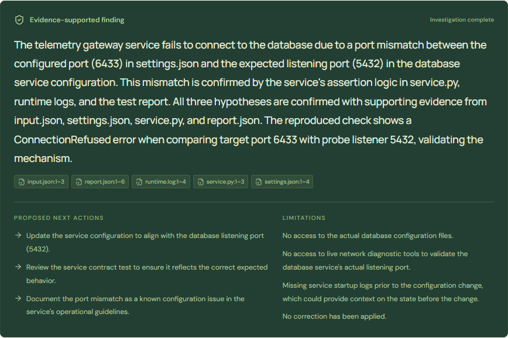

# A three-minute demonstration

This walkthrough uses actual inference and sources. It does not claim a production repair.

1. Start the tested Ollama model and run `python -m tracemedic.cli serve` from the installed environment. Open [the local workbench](http://127.0.0.1:8000).
2. Choose **Telemetry gateway**. Explain the input: captured logs, source, configuration, inputs and supplied test report from an injected synthetic bug.
3. Start **Multi-agent**. Expand a coordinator delegation to show the LLM's task and hypothesis IDs. Watch actual MCP calls appear; there is no synthetic progress percentage.
4. Open a source citation. Compare `settings.json` port 6433 with `input.json` listener 5432 and the assertion in `service.py`. The excerpt has captured line numbers and a file hash.
5. Show the verifier's `run_check` result. It executed the immutable fixture in a subprocess; it did not connect to a live database. Review rejected/unresolved hypotheses as well as confirmations.
6. Read the finding, limitations and next actions. State explicitly that no correction has been applied.
7. Run another investigation, Cancel during an action, then Resume. The same ID and evidence remain. For the stronger process-death demonstration, show `docs/evidence/real-recovery.json` or execute `python scripts/prove_recovery.py`.
8. Open Benchmark and explain both correctness and overhead from the published per-incident results. A larger number of roles is not evidence of better reasoning.

## Replay without new inference

```powershell
.\.venv\Scripts\python.exe scripts/import_demo.py
.\.venv\Scripts\python.exe -m tracemedic.cli serve
```

Open Investigations and select the original recorded real-model run. `demo-real.json` includes native actions, actual tool results, measured usage and cancellation/resume events. Replay neither calls a model nor reconstructs resumable graph state. This distinction matters when presenting offline.

Reproduce the browser walkthrough against a running server with Edge/Chromium:

```powershell
node frontend/scripts/browser-qa.mjs --replay
# Launch a new real browser run, cancel, resume and export its evidence:
node frontend/scripts/browser-qa.mjs --real
```

The Playwright QA uses the actual local API, without mocked responses. It saves desktop/mobile/tablet captures, the source inspector and the final finding. `--real` also writes a new real trace. Keep published benchmark artifacts unchanged when recording a new demo.


